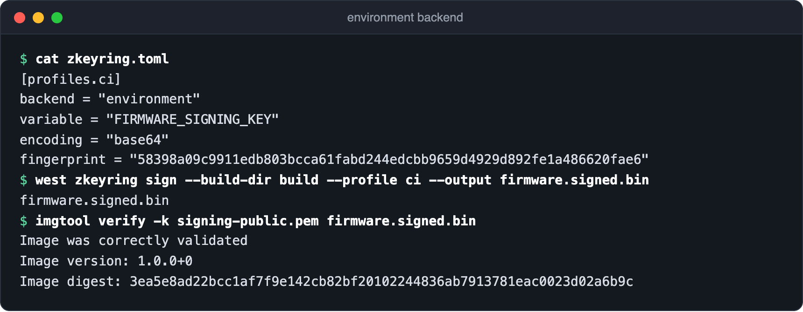

environment
===========

Read the signing key from an environment variable set by your CI system.

.. list-table::
   :widths: 30 70

   * - **Private key is stored in**
     - The secret store of the CI system
   * - **Signing happens in**
     - The zkeyring process
   * - **Signing job needs**
     - The secret variable
   * - **Good for**
     - A simple protected CI job

Create the key
--------------

Generate the key on a trusted machine and store it as a CI secret. A
single-line base64 value avoids problems with multiline secrets.

.. code-block:: sh

   umask 077
   openssl genpkey -algorithm EC -pkeyopt ec_paramgen_curve:P-256 -out release.pem
   openssl pkey -in release.pem -pubout -out signing-public.pem
   base64 < release.pem | tr -d '\n'

Copy the last output into the secret, then delete ``release.pem`` or move it to
secure backup storage.

Configure the profile
---------------------

.. code-block:: toml

   [profiles.ci]
   backend = "environment"
   variable = "FIRMWARE_SIGNING_KEY"
   encoding = "base64"
   fingerprint = "<public key fingerprint>"

``encoding = "pem"`` is the default and accepts the multiline PEM.

Compute the fingerprint from the public key.

.. code-block:: sh

   west zkeyring fingerprint signing-public.pem

Sign
----

.. code-block:: sh

   west zkeyring sign --build-dir build --profile ci \
       --output firmware.signed.bin
   imgtool verify -k signing-public.pem firmware.signed.bin

   Sign with a base64 key from the environment.

GitHub Actions
--------------

Use a protected environment and expose the secret to the signing step only.

.. code-block:: yaml

   jobs:
     sign:
       environment: release
       steps:
         # Check out the workspace and download the deferred build here.
         - name: Sign firmware
           env:
             FIRMWARE_SIGNING_KEY: ${{ secrets.FIRMWARE_SIGNING_KEY }}
           run: |
             west zkeyring sign --build-dir build --profile ci \
                 --output firmware.signed.bin

See :ref:`deferred-signing` for the files to transfer.

Security notes
--------------

- Every process started in the signing step inherits the variable, except
  imgtool, from which zkeyring removes it.
- Do not expose the secret to pull requests from forks.
- For releases, prefer a remote backend so the job cannot read the key.

Rotate
------

Create a new key, replace the secret and the fingerprint together, and build
the bootloader with the new public key.

Troubleshoot
------------

*set FIRMWARE_SIGNING_KEY to use the signing backend*
   The variable is missing or empty in this step.

   .. figure:: ../images/environment-missing.png
      :alt: west zkeyring sign fails with the message set FIRMWARE_SIGNING_KEY to use the signing backend.

*invalid base64 signing key* or *expected an unencrypted PEM signing key*
   Check ``encoding`` and the value of the secret.
