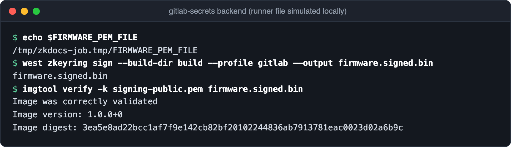

gitlab-secrets
==============

Read the signing key from a file that GitLab Runner creates for the job.

.. list-table::
   :widths: 30 70

   * - **Private key is stored in**
     - GitLab Secrets Manager, or a file-type CI/CD variable
   * - **Signing happens in**
     - The zkeyring process
   * - **Signing job needs**
     - A job allowed to receive the secret
   * - **Good for**
     - GitLab CI

Create the key
--------------

Generate the key on a trusted machine.

.. code-block:: sh

   umask 077
   openssl genpkey -algorithm EC -pkeyopt ec_paramgen_curve:P-256 -out release.pem
   openssl pkey -in release.pem -pubout -out signing-public.pem
   west zkeyring fingerprint signing-public.pem

Store the content of ``release.pem`` in one of these places, then delete the
file or move it to secure backup storage.

.. tab-set::

   .. tab-item:: Secrets Manager

      Create a secret named ``firmware_signing_key`` and reference it in the
      job. See the `GitLab documentation
      <https://docs.gitlab.com/ci/secrets/secrets_manager/#use-secrets-in-job-scripts>`__.

      .. code-block:: yaml

         sign_firmware:
           secrets:
             FIRMWARE_PEM_FILE:
               gitlab_secrets_manager:
                 name: firmware_signing_key
           script:
             - west zkeyring sign --build-dir build --profile gitlab

   .. tab-item:: File variable

      Create a protected CI/CD variable named ``FIRMWARE_PEM_FILE`` with the
      **File** type.

      .. code-block:: yaml

         sign_firmware:
           script:
             - west zkeyring sign --build-dir build --profile gitlab

In both cases, the variable contains the absolute path of a temporary file. If
the job uses ``file: false``, the variable contains the key itself. Use the
:doc:`environment` backend.

Configure the profile
---------------------

.. code-block:: yaml

   profiles:

     gitlab:
       backend: "gitlab-secrets"
       variable: "FIRMWARE_PEM_FILE"
       fingerprint: "<public key fingerprint>"

Sign
----

   Sign with a key file. The runner file is simulated locally in this capture.

Security notes
--------------

- Restrict the secret to protected branches or tags.
- Use a dedicated runner for signing. Other jobs on a shared runner may be able
  to reach its files.
- The job can read the key. For releases, prefer a remote backend.

Rotate
------

Create a new key, replace the secret and the fingerprint together, and build
the bootloader with the new public key.

Troubleshoot
------------

*the GitLab secret variable must point to an absolute file*
   The variable contains the key instead of a path, or the file does not exist.
   Check the variable type.
