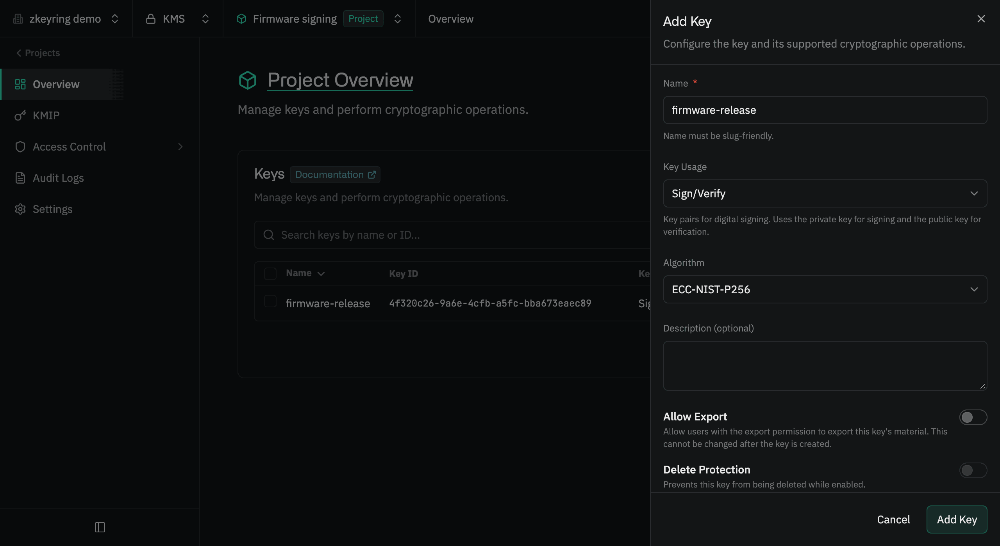
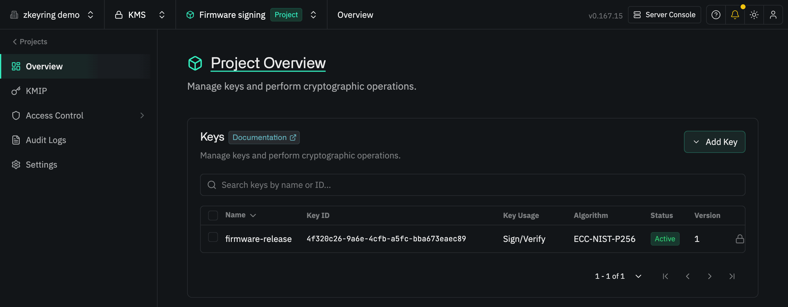
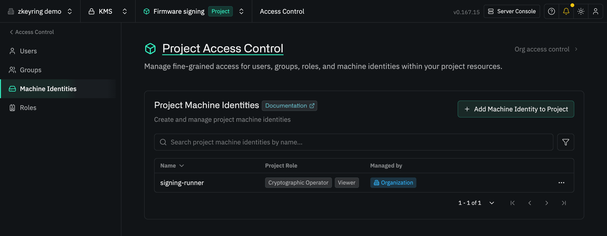
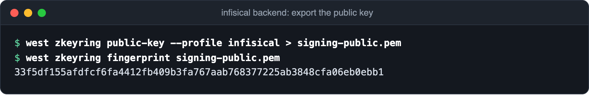

infisical
=========

Sign with a non-exportable key in Infisical KMS.

.. list-table::
   :widths: 30 70

   * - **Private key is stored in**
     - Infisical KMS
   * - **Signing happens in**
     - Infisical
   * - **Signing job needs**
     - A machine identity access token
   * - **Good for**
     - Release signing with keys managed in a web interface

The captures on this page use Infisical v0.167.15. The interface may differ in
other versions.

Create the key
--------------

In a KMS project, select **Add Key**, then **Create Key**.

#. Set **Key Usage** to *Sign/Verify*.
#. Set **Algorithm** to *ECC-NIST-P256*.
#. Turn off **Allow Export**.

.. important::

   **Allow Export** is on by default and cannot be changed after the key is
   created. zkeyring refuses an exportable key.

   The form for a firmware signing key.

Copy the **Key ID** and note the **Version**.

   The key ID and version to use in the profile.

Create a machine identity
-------------------------

Add a machine identity to the project with permission to read the key and its
public key, and to sign. The built-in *Viewer* and *Cryptographic Operator*
roles together provide this. A custom role can be narrower.

   A machine identity for the signing job.

Obtain a short-lived access token for this identity and set it as
``INFISICAL_TOKEN`` in the signing job.

Configure the profile
---------------------

.. code-block:: yaml

   profiles:

     infisical:
       backend: "infisical"
       url: "https://app.infisical.com"
       key: "<key ID>"
       version: 1

``INFISICAL_API_URL``, when set, takes precedence over ``url``.

Export the public key and add its fingerprint to the profile.

.. code-block:: sh

   west zkeyring public-key --profile infisical > signing-public.pem
   west zkeyring fingerprint signing-public.pem

   Export the public key and compute its fingerprint.

Sign
----

.. code-block:: sh

   west zkeyring sign --build-dir build --profile infisical \
       --output firmware.signed.bin
   imgtool verify -k signing-public.pem firmware.signed.bin

Successful verification prints ``Image was correctly validated``.

Security notes
--------------

- The token holder can request signatures but cannot read the key.
- Use a dedicated project for signing keys, because roles apply to the project.
- A ``~/.netrc`` entry for the Infisical host replaces the token. See
  :ref:`network-environment`.

Rotate
------

.. warning::

   Infisical signs with the **current** version of a key. The profile pins that
   version, and signing stops if it changes. Plan a rotation together with the
   new bootloader key, or create a separate key.

Troubleshoot
------------

*Infisical signing requires a non-exportable sign/verify key*
   Create a new key with **Allow Export** off and the *Sign/Verify* usage.

*Infisical current key version does not match the profile*
   The key was rotated. Confirm the change before updating ``version`` and
   ``fingerprint``.

*signing service returned HTTP 401* or *403*
   The token expired or was revoked, or the identity lacks a permission.
