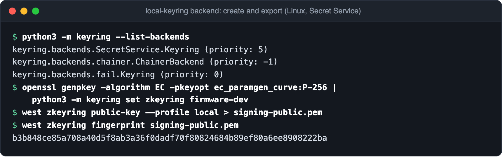

local-keyring
=============

Read the signing key from the credential store of your operating system.

.. list-table::
   :widths: 30 70

   * - **Private key is stored in**
     - macOS Keychain, Secret Service or KWallet on Linux, or Windows Credential Locker
   * - **Signing happens in**
     - The zkeyring process
   * - **Signing job needs**
     - An unlocked OS session
   * - **Good for**
     - A developer key on one machine

Create the key
--------------

Pipe a new P-256 key into the store. ``zkeyring`` is the service and
``firmware-dev`` the account name. Choose your own.

.. code-block:: sh

   openssl genpkey -algorithm EC -pkeyopt ec_paramgen_curve:P-256 |
       python -m keyring set zkeyring firmware-dev

.. warning::

   ``keyring set`` replaces an existing entry with the same names. A development
   key stored only here is lost with the machine.

Configure the profile
---------------------

.. code-block:: toml

   [profiles.local]
   backend = "local-keyring"
   service = "zkeyring"
   key = "firmware-dev"

Export the public key and add its fingerprint to the profile.

.. code-block:: sh

   west zkeyring public-key --profile local > signing-public.pem
   west zkeyring fingerprint signing-public.pem

   Create and export a key on Linux with GNOME Keyring.

Sign
----

.. code-block:: sh

   west zkeyring sign --build-dir build --profile local \
       --output firmware.signed.bin
   imgtool verify -k signing-public.pem firmware.signed.bin

.. tab-set::

   .. tab-item:: Linux

      .. figure:: ../images/local-keyring-sign.png
         :alt: The profile, a successful signature and a successful imgtool verification on Linux.

         Sign with a key from Secret Service.

   .. tab-item:: macOS

      .. figure:: ../images/local-keyring-macos.png
         :alt: The Keychain entry metadata, a successful signature and a successful imgtool verification on macOS.

         Sign with a key from macOS Keychain.

Security notes
--------------

- zkeyring accepts native credential stores only. It refuses file-based and
  third-party keyring plugins.
- macOS may ask you to allow access when another Python interpreter reads the
  entry.
- Any program running in your session may be able to read the key. Use it for
  development only.
- A headless Linux machine usually has no Secret Service. Use
  :doc:`environment` or a remote backend there.

Rotate
------

Store a new key under a new account name, pin its fingerprint, and rebuild the
bootloader with the new public key.

Troubleshoot
------------

*no supported OS credential store is available*
   Run ``python -m keyring --list-backends`` and check that a native store is
   listed and unlocked.

*signing key was not found in the OS credential store*
   Check ``service`` and ``key``.
