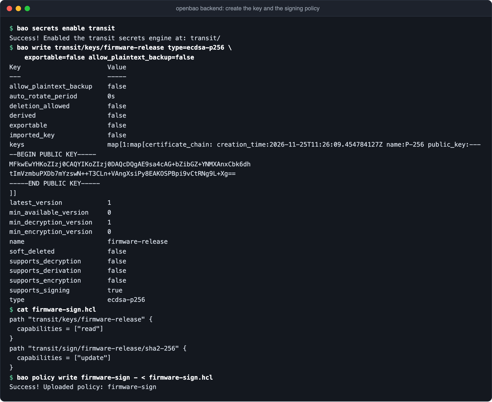
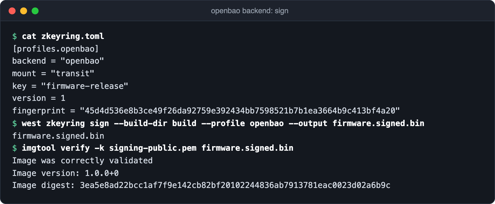
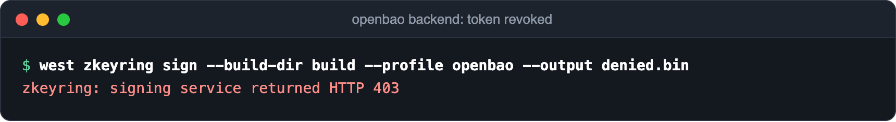

openbao
=======

Sign with a non-exportable key in the Transit engine of OpenBao.

.. list-table::
   :widths: 30 70

   * - **Private key is stored in**
     - OpenBao Transit
   * - **Signing happens in**
     - OpenBao
   * - **Signing job needs**
     - A OpenBao token that can use one key
   * - **Good for**
     - Release signing with an open source service

Create the key
--------------

Enable the engine and create an ``ecdsa-p256`` key.

.. code-block:: sh

   bao secrets enable transit
   bao write transit/keys/firmware-release type=ecdsa-p256 \
       exportable=false allow_plaintext_backup=false

.. important::

   zkeyring refuses a key that is exportable or allows plaintext backup.

Create a policy that can read the public key and request SHA-256 signatures
with this key.

.. code-block:: text

   path "transit/keys/firmware-release" {
     capabilities = ["read"]
   }
   path "transit/sign/firmware-release/sha2-256" {
     capabilities = ["update"]
   }

.. code-block:: sh

   bao policy write firmware-sign - < firmware-sign.hcl

   Create the key and the policy.

.. tab-set::

   .. tab-item:: Key

      .. figure:: ../images/openbao-ui-key.png
         :alt: OpenBao web interface showing the firmware-release key of type ecdsa-p256.
         :class: ui

         The key in the OpenBao web interface.

   .. tab-item:: Versions

      .. figure:: ../images/openbao-ui-versions.png
         :alt: OpenBao web interface showing version 1 of the firmware-release key.
         :class: ui

         The version number to pin in the profile.

   .. tab-item:: Policy

      .. figure:: ../images/openbao-ui-policy.png
         :alt: OpenBao web interface showing the firmware-sign policy.
         :class: ui

         The policy in the OpenBao web interface.

Create a short-lived token for the signing job, or use an auth method of your
CI system.

.. code-block:: sh

   bao token create -policy=firmware-sign -no-default-policy -ttl=15m

Configure the profile
---------------------

.. code-block:: toml

   [profiles.openbao]
   backend = "openbao"
   mount = "transit"
   key = "firmware-release"
   version = 1

Set ``BAO_ADDR`` and ``BAO_TOKEN`` in the environment, and
``BAO_NAMESPACE`` if you use namespaces. The profile can set ``url`` instead of
``BAO_ADDR``.

Export the public key and add its fingerprint to the profile.

.. code-block:: sh

   west zkeyring public-key --profile openbao > signing-public.pem
   west zkeyring fingerprint signing-public.pem

Sign
----

.. code-block:: sh

   west zkeyring sign --build-dir build --profile openbao \
       --output firmware.signed.bin
   imgtool verify -k signing-public.pem firmware.signed.bin

   OpenBao signs the digest. The private key stays in the service.

Revoke access
-------------

Revoke the token to stop the signing job immediately. The key does not change.

   A revoked token can no longer sign.

Security notes
--------------

- The token holder can request signatures but cannot read the key.
- Enable an audit device to record each signature request.
- Administrators can change the policy or the key. Protect these permissions
  separately.
- See :ref:`network-environment` for proxies.

Rotate
------

Rotate the key in Transit.

.. code-block:: sh

   bao write -f transit/keys/firmware-release/rotate

Signing continues with the pinned version. To move to the new key, build a
bootloader that trusts its public key, then change ``version`` and
``fingerprint`` together.

Troubleshoot
------------

*OpenBao Transit key must be of type ecdsa-p256*
   Create a key of the right type.

*OpenBao Transit requires a non-exportable key without plaintext backup*
   Create a new key with the options above.

*OpenBao Transit key version has no public key*
   The pinned ``version`` does not exist.

*signing service returned HTTP 403*
   The token is invalid or revoked, or the policy does not cover both paths.
