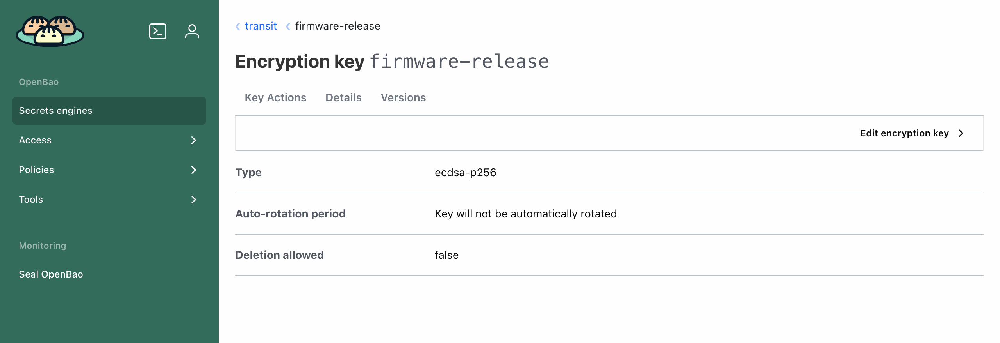
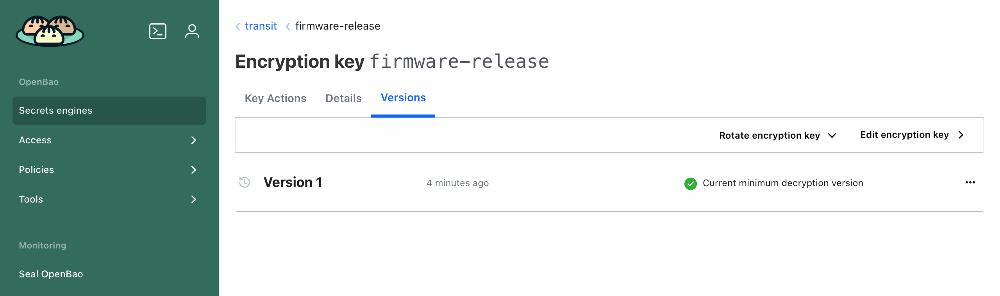
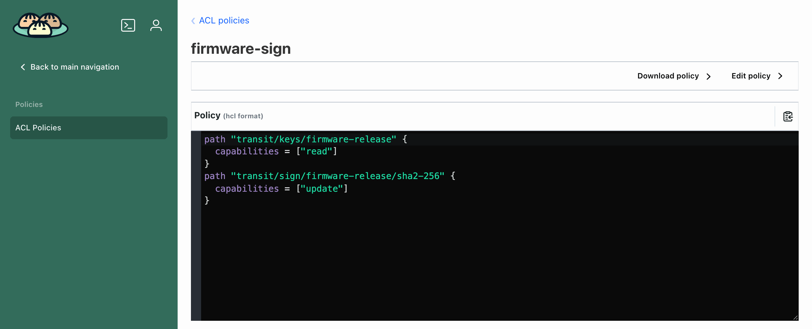

openbao
=======

Sign with a non-exportable key in the Transit engine of OpenBao.

.. list-table::
   :widths: 30 70

   * - **Private key is stored in**
     - OpenBao Transit
   * - **Signing happens in**
     - OpenBao
   * - **Signing job needs**
     - An OpenBao token that can use one key
   * - **Good for**
     - Release (and dev.) signing with an open source service

Create the key
--------------

Open ``/ui/`` on your OpenBao server and sign in with an account that can
manage secrets engines and ACL policies. For a self-hosted server, see how to
`enable the web interface <https://openbao.org/docs/configuration/ui/>`_.

#. In **Secrets engines**, enable **Transit** at the path ``transit``.
#. Open ``transit`` and create a key named ``firmware-release``.
#. Select ``ecdsa-p256`` as the key type. Leave key export and plaintext backup
   disabled, then save the key.

.. important::

   zkeyring refuses a key that is exportable or allows plaintext backup.

Open the key's **Details** tab to check its type.

   The signing key in Transit.

In **Versions**, note the number to use in the zkeyring profile. A new key
starts at version ``1``.

   Copy the version number into the profile.

Create the signing policy
-------------------------

Open **Policies**, then **ACL Policies**. Create a policy named
``firmware-sign`` and paste the HCL below into the policy editor. It grants
read access to the public key metadata and permission to request SHA-256
signatures with this key.

.. code-block:: text

   path "transit/keys/firmware-release" {
     capabilities = ["read"]
   }
   path "transit/sign/firmware-release/sha2-256" {
     capabilities = ["update"]
   }

   The saved policy for the signing job.

.. dropdown:: Configure the key and policy from the CLI

   Save the policy above as ``firmware-sign.hcl``.

   .. code-block:: sh

      bao secrets enable transit
      bao write transit/keys/firmware-release type=ecdsa-p256 \
          exportable=false allow_plaintext_backup=false
      bao policy write firmware-sign - < firmware-sign.hcl

Create a short-lived token for the signing job, or use an auth method of your
CI system.

.. code-block:: sh

   bao token create -policy=firmware-sign -no-default-policy -ttl=15m

Configure the profile
---------------------

Create ``zkeyring.yaml`` in the application directory, or add the ``openbao``
entry under ``profiles`` in your existing file.

.. code-block:: yaml
   :caption: zkeyring.yaml

   profiles:

     openbao:
       backend: "openbao"
       mount: "transit"
       key: "firmware-release"
       version: 1

Two choices exist for the profile:

- Using environment variables, easy to set up in a CI job with ``BAO_ADDR``
  and ``BAO_TOKEN`` in the environment.

- Use ``west zkeyring login --profile openbao`` with an OIDC auth mount. Set
  ``BAO_NAMESPACE`` if you use namespaces.

You can set ``url`` and ``namespace`` in the ``openbao`` profile.

``BAO_ADDR`` and ``BAO_NAMESPACE`` take precedence.

From the application directory, export the public key and compute its
fingerprint.

.. code-block:: sh

   west zkeyring public-key --profile openbao > signing-public.pem
   west zkeyring fingerprint signing-public.pem

Add these fields to the ``openbao`` profile in ``zkeyring.yaml``. Use the
fingerprint printed by the command. The public key path is relative to the
profile file.

.. code-block:: yaml

   public_key: "signing-public.pem"
   fingerprint: "<64 lowercase hexadecimal digits>"

Sign with sysbuild
------------------

Enable build-time signing and select the OpenBao profile in ``prj.conf``.

.. code-block:: cfg
   :caption: prj.conf

   CONFIG_ZSIGNING=y
   CONFIG_ZSIGNING_PROFILE="openbao"
   CONFIG_ZSIGNING_DEFERRED=n

Enable MCUboot with ECDSA P-256 in ``sysbuild.conf`` and use the profile's
public key as its verification key.

.. code-block:: cfg
   :caption: sysbuild.conf

   SB_CONFIG_BOOTLOADER_MCUBOOT=y
   SB_CONFIG_ZKEYRING_SIGNATURE_ECDSA_P256=y
   SB_CONFIG_ZKEYRING_PROFILE_PUBLIC_KEY=y

Run the build from the application directory with your OpenBao credentials
available. zkeyring requests the signature from OpenBao as part of the build.

.. code-block:: sh

   west build -b <board> --sysbuild -d build .

The signed image is ``build/<application>/zephyr/zephyr.signed.bin``.

Sign in a separate job
----------------------

For :ref:`deferred-signing`, set ``CONFIG_ZSIGNING_DEFERRED=y`` in
``prj.conf`` and rebuild with ``west build --sysbuild``. Sign the resulting
image from the job that has access to OpenBao.

.. code-block:: sh

   west zkeyring sign --build-dir build --profile openbao \
       --output firmware.signed.bin
   imgtool verify -k signing-public.pem firmware.signed.bin

Revoke access
-------------

Revoke the token to stop the signing job immediately. Subsequent requests with
that token fail with ``signing service returned HTTP 403``.

Security notes
--------------

- The token holder can read the public key metadata and request signatures.
- Enable an audit device to record each signature request.
- Administrators can change the policy or the key. Protect these permissions
  separately.
- See :ref:`network-environment` for proxies.

Rotate
------

In **Secrets engines**, open ``transit`` and select ``firmware-release``. In
**Versions**, select **Rotate encryption key** and confirm the rotation.

For CLI-based rotation, run the following command.

.. code-block:: sh

   bao write -f transit/keys/firmware-release/rotate

Signing continues with the pinned version. To move to the new key, build a
bootloader that trusts its public key, then change ``version`` and
``fingerprint`` together.

Troubleshoot
------------

*OpenBao Transit key must be of type ecdsa-p256*
   Create a key of the right type.

*OpenBao Transit requires a non-exportable key without plaintext backup*
   Create a new key with the options above.

*OpenBao Transit key version has no public key*
   The pinned ``version`` does not exist.

*signing service returned HTTP 403*
   The token is invalid or revoked, or the policy does not cover both paths.
