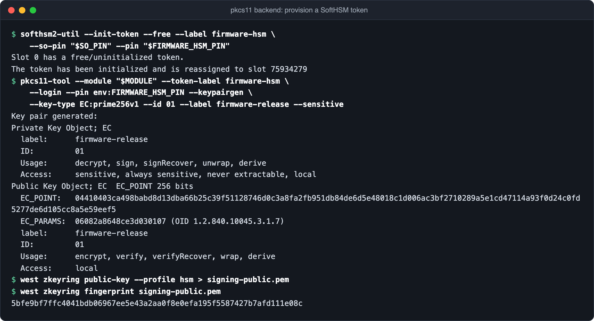

pkcs11
======

Sign with a key in a hardware security module, smart card or software token
through its PKCS#11 module.

.. list-table::
   :widths: 30 70

   * - **Private key is stored in**
     - The PKCS#11 token
   * - **Signing happens in**
     - The token
   * - **Signing job needs**
     - The PKCS#11 module, access to the token and its PIN
   * - **Good for**
     - Release signing with hardware protection

Install the Python support.

.. code-block:: sh

   python -m pip install 'python-pkcs11>=0.9'

Create the key
--------------

The token needs a P-256 private key that is sensitive and non-extractable, and
its public key. Both objects must have the same ``CKA_ID``. Follow your
vendor's instructions for a hardware token.

This example uses SoftHSM, a software token for testing, and ``pkcs11-tool``
from OpenSC.

.. code-block:: sh

   MODULE=/usr/lib/softhsm/libsofthsm2.so
   softhsm2-util --init-token --free --label firmware-hsm \
       --so-pin "$SO_PIN" --pin "$FIRMWARE_HSM_PIN"
   pkcs11-tool --module "$MODULE" --token-label firmware-hsm \
       --login --pin env:FIRMWARE_HSM_PIN --keypairgen \
       --key-type EC:prime256v1 --id 01 --label firmware-release --sensitive

``Access: sensitive, always sensitive, never extractable`` confirms the
protection of the private key.

   Provision a SoftHSM token and export the public key.

Configure the profile
---------------------

.. code-block:: yaml

   profiles:

     hsm:
       backend: "pkcs11"
       module: "/usr/lib/softhsm/libsofthsm2.so"
       token: "firmware-hsm"
       key: "01"
       pin_variable: "FIRMWARE_HSM_PIN"

``module``
   Path of the vendor's PKCS#11 library.

``token``
   Token label.

``key``
   ``CKA_ID`` of the key, in hexadecimal.

``pin_variable``
   Name of the environment variable that contains the user PIN.

Export the public key and add its fingerprint to the profile.

.. code-block:: sh

   west zkeyring public-key --profile hsm > signing-public.pem
   west zkeyring fingerprint signing-public.pem

Sign
----

.. code-block:: sh

   west zkeyring sign --build-dir build --profile hsm \
       --output firmware.signed.bin
   imgtool verify -k signing-public.pem firmware.signed.bin

The token signs the digest with ``CKM_ECDSA``. Successful verification prints
``Image was correctly validated``.

Security notes
--------------

- zkeyring refuses a key that is extractable or not sensitive.

  .. figure:: ../images/pkcs11-extractable.png
     :alt: west zkeyring sign fails with PKCS#11 signing requires a sensitive non-extractable key.

     An extractable key is refused.

- Set the PIN in the signing process only. zkeyring removes it from the
  environment of imgtool.
- A token may lock after several wrong PINs.
- SoftHSM stores keys on disk. Use it for testing only.

Rotate
------

Create a key with a new ``CKA_ID``, build a bootloader that trusts its public
key, then change ``key`` and ``fingerprint`` together.

Troubleshoot
------------

*install python-pkcs11 to use this provider*
   Install the package in the virtual environment that contains west.

*PKCS#11 module file does not exist*
   Check ``module``.

*could not open the PKCS#11 token*
   Check the token label and the vendor's configuration. For SoftHSM, check
   ``SOFTHSM2_CONF``.

*could not read the PKCS#11 public key*
   Check the PIN, and that a P-256 public key with this ``CKA_ID`` exists.
