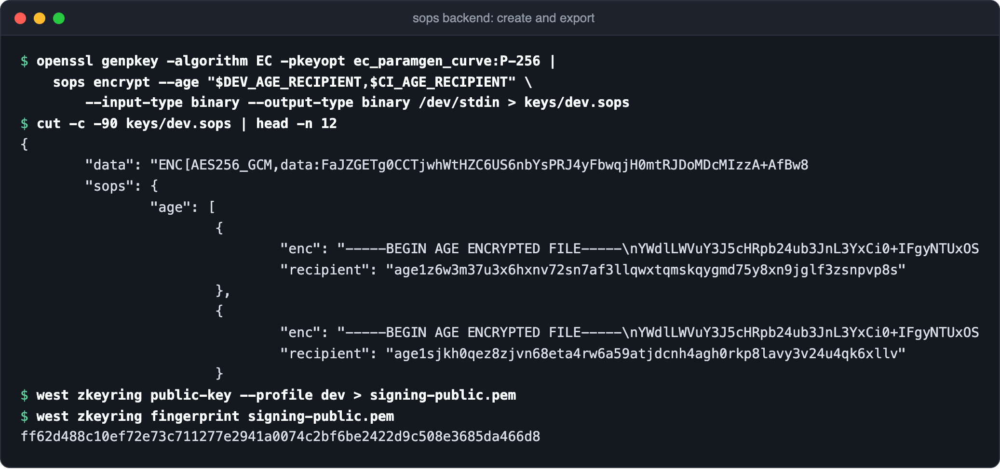
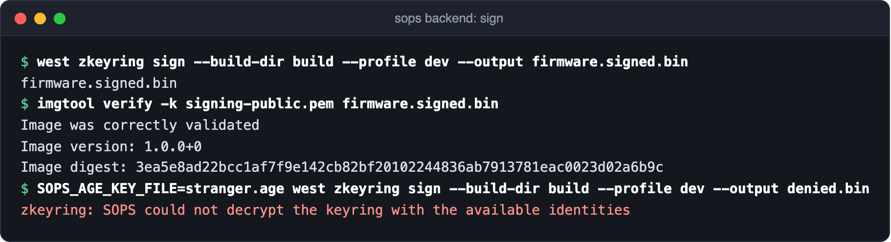

sops
====

Keep the signing key encrypted in your repository with
`SOPS <https://getsops.io>`_. This page uses
`age <https://age-encryption.org>`_ identities.

.. list-table::
   :widths: 30 70

   * - **Private key is stored in**
     - An encrypted file, for example ``keys/dev.sops``
   * - **Signing happens in**
     - The zkeyring process
   * - **Signing job needs**
     - ``sops`` and an authorized age identity
   * - **Good for**
     - A small team that shares a development key through Git

Create the identities
---------------------

Create one identity for each developer and one for CI. Keep each identity file
private and exchange the public recipients.

.. code-block:: sh

   age-keygen -o dev.age
   age-keygen -y dev.age

SOPS reads the identity from ``SOPS_AGE_KEY_FILE``, from ``SOPS_AGE_KEY``, or
from its standard location. Do not commit it.

Create the key
--------------

Pipe a new P-256 key into SOPS so the plain key is not written to a file.

.. code-block:: sh

   mkdir -p keys
   openssl genpkey -algorithm EC -pkeyopt ec_paramgen_curve:P-256 |
       sops encrypt --age "$DEV_AGE_RECIPIENT,$CI_AGE_RECIPIENT" \
           --input-type binary --output-type binary /dev/stdin > keys/dev.sops

Configure the profile
---------------------

``keyring`` is relative to the profile file.

.. code-block:: yaml

   profiles:

     dev:
       backend: "sops"
       keyring: "keys/dev.sops"

Export the public key and add its fingerprint to the profile.

.. code-block:: sh

   west zkeyring public-key --profile dev > signing-public.pem
   west zkeyring fingerprint signing-public.pem

   The encrypted file lists its recipients and contains no readable key.

Sign
----

.. code-block:: sh

   west zkeyring sign --build-dir build --profile dev \
       --output firmware.signed.bin
   imgtool verify -k signing-public.pem firmware.signed.bin

   An authorized identity signs. Another identity is refused.

In CI, provide the dedicated identity through the protected variable
``SOPS_AGE_KEY``.

Remove a recipient
------------------

List the remaining recipients in ``.sops.yaml``.

.. code-block:: yaml

   creation_rules:
     - path_regex: '^keys/dev\.sops$'
       age: '<remaining age recipients, comma-separated>'

Apply the change and rotate the data key of the file.

.. code-block:: sh

   sops updatekeys keys/dev.sops
   sops rotate --in-place --input-type binary --output-type binary keys/dev.sops

.. important::

   A removed recipient can still decrypt old copies from the Git history. To
   retire the key, create a new signing key and update the bootloader.

Security notes
--------------

- zkeyring reads the decrypted key through a pipe.
- Every recipient can extract the key. Use one file per group of recipients.

Troubleshoot
------------

*could not run SOPS*
   Install ``sops`` and check that it is in ``PATH``. Decryption is limited to
   30 seconds.

*SOPS could not decrypt the keyring with the available identities*
   Check the file path, and that your identity is one of its recipients.
