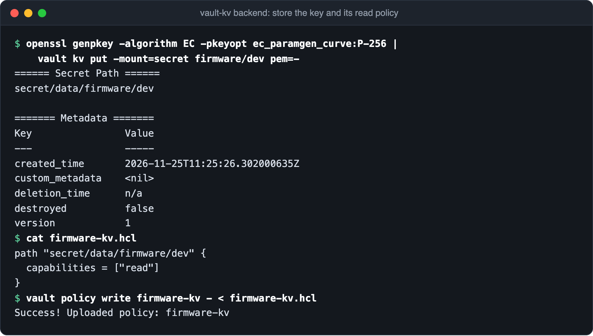
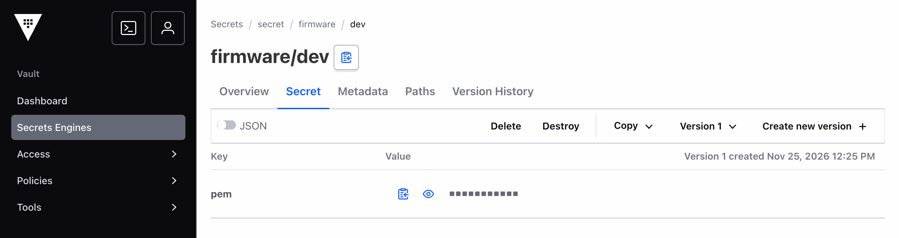
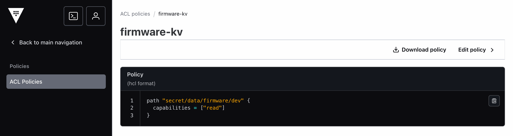
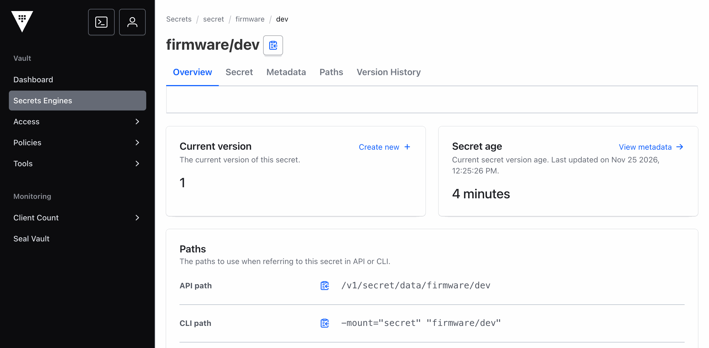

vault-kv
========

Read the signing key from a versioned secret in HashiCorp Vault's KV version 2
engine.

.. list-table::
   :widths: 30 70

   * - **Private key is stored in**
     - Vault KV v2
   * - **Signing happens in**
     - The zkeyring process
   * - **Signing job needs**
     - A Vault token with read access to one secret
   * - **Good for**
     - Central storage and access control for an existing PEM key

.. tip::

   If you can create a new key, prefer :doc:`vault-transit`. The key then never
   leaves Vault.

Store the key
-------------

.. code-block:: sh

   openssl genpkey -algorithm EC -pkeyopt ec_paramgen_curve:P-256 |
       vault kv put -mount=secret firmware/dev pem=-

Create a policy that allows reading this secret only.

.. code-block:: text

   path "secret/data/firmware/dev" {
     capabilities = ["read"]
   }

.. code-block:: sh

   vault policy write firmware-kv - < firmware-kv.hcl

   Store the key and create its policy. Note the version number.

   The secret in the Vault web interface.

   The policy in the Vault web interface.

Create a short-lived token for the signing job, or use a Vault auth method of
your CI system.

.. code-block:: sh

   vault token create -policy=firmware-kv -no-default-policy -ttl=15m

Configure the profile
---------------------

.. code-block:: yaml

   profiles:

     kv:
       backend: "vault-kv"
       mount: "secret"
       path: "firmware/dev"
       field: "pem"
       version: 1

Set ``encoding: base64`` if the field contains an encoded PEM. Set
``VAULT_ADDR`` and ``VAULT_TOKEN`` in the environment, and ``VAULT_NAMESPACE``
if you use namespaces. The profile can set ``url`` and ``namespace`` instead.
``VAULT_ADDR`` and ``VAULT_NAMESPACE`` take precedence.

Export the public key and add its fingerprint to the profile.

.. code-block:: sh

   west zkeyring public-key --profile kv > signing-public.pem
   west zkeyring fingerprint signing-public.pem

Sign
----

.. code-block:: sh

   west zkeyring sign --build-dir build --profile kv \
       --output firmware.signed.bin
   imgtool verify -k signing-public.pem firmware.signed.bin

Successful verification prints ``Image was correctly validated``.

Security notes
--------------

- The token holder can read the key. Keep its lifetime short.
- Vault's access control and audit devices cover reads of the secret. They do
  not see individual signatures.
- See :ref:`network-environment` for proxies.

Rotate
------

Write a new version of the secret. Signing continues with the pinned version
until you change ``version`` and ``fingerprint`` and rebuild the bootloader.

   The current version and the API path of the secret.

Troubleshoot
------------

*signing service returned HTTP 403*
   The policy path must contain ``data/``, as in ``secret/data/firmware/dev``.
   The profile ``path`` must not.

*Vault KV v2 returned no signing key*
   Check that the mount uses KV version 2.

*missing or invalid pem*
   The secret has no field with the name set in ``field``.
