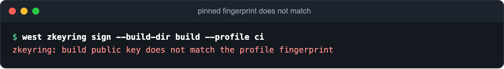

Concepts
========

The problem
-----------

MCUboot only starts firmware signed with a key it trusts. In the default Zephyr
workflow, the build reads that private key from a PEM file. Every developer and
every CI runner that builds the firmware then has a copy of the key, and a
copied key cannot be recalled: anyone who holds it can sign firmware your
devices will accept.

zkeyring separates building from signing:

- the **build** needs the public key;
- the **backend** holds the private key;
- **zkeyring** connects the two and checks the result.

How an image is signed
----------------------

.. raw:: html
   :file: diagrams/flow.svg

When ``CONFIG_ZSIGNING`` is enabled, zkeyring replaces Zephyr's MCUboot signing
script. The build exports three files:

``zephyr/zephyr.bin``
   The unsigned image.

``zkeyring-sign.json``
   The image parameters: version, header size, slot size, alignment and
   upgrade mode.

``zkeyring-public.pem``
   The public key of the bootloader configuration.

``west zkeyring sign`` then performs these steps.

#. Compare the fingerprint pinned in the profile with the build's public key
   and with the backend's public key.
#. Ask MCUboot's ``imgtool`` for the SHA-256 digest to sign.
#. Ask the backend to sign the 32-byte digest using the key's algorithm.
#. Verify the signature against the digest and the public key.
#. Ask ``imgtool`` to embed the signature in the image.
#. Ask ``imgtool`` to verify the complete image, then move it into place.

The work happens in a temporary directory next to the output. If a step fails,
zkeyring exits with an error and leaves any previous output unchanged.

.. _key-custody:

Where the private key is used
-----------------------------

.. raw:: html
   :file: diagrams/custody.svg

This is the most important difference between backends.

**In-process backends** load the PEM into the zkeyring process. They protect
the key at rest and control who receives it. A compromised signing job can leak
the key itself.

**Remote backends** send the digest to a service or token and receive a
signature. A compromised signing job can request signatures while its
credential is valid. It cannot take the key with it.

Use a remote backend for release keys where possible.

.. _fingerprint-pinning:

Fingerprint pinning
-------------------

A profile names a key, for example ``transit/firmware-release``. A name does
not prove which key answers. The profile therefore pins a **fingerprint**: the
lowercase SHA-256 of the DER-encoded SubjectPublicKeyInfo of the public key.

Signing requires the fingerprint. It must match both the build's public key and
the backend's public key. This detects a wrong profile, a replaced key or a
bootloader built for another key before any signature is requested.

   A profile whose fingerprint does not match the build.

To pin a new key:

#. Leave ``fingerprint`` out of the profile and run
   ``west zkeyring public-key``.
#. Run ``west zkeyring fingerprint`` on the exported PEM.
#. Confirm the value through a trusted channel, for example with the person who
   created the key.
#. Add it to the profile.

What zkeyring protects
----------------------

.. list-table::
   :header-rows: 1
   :widths: 45 55

   * - Protection
     - How
   * - The build never reads the private key
     - The CMake hook rejects a PEM that contains a private key
   * - The expected key signs
     - Fingerprint pinning, plus pinned key versions for remote services
   * - Remote keys cannot be exported
     - Transit, Infisical and PKCS#11 keys must be non-exportable
   * - A bad signature is not published
     - Verified twice before the output is replaced
   * - Service traffic is protected
     - HTTPS is required except on loopback, and redirects are refused
   * - Credentials are not passed to imgtool by default
     - Known tokens and the variables named in the profile are removed from its
       environment

What it does not protect
------------------------

- **The firmware content.** zkeyring signs the image it is given. Review and
  reproducible builds remain your responsibility.
- **A compromised signing machine.** It can sign malicious images while it has
  access.
- **MCUboot trust.** A leaked key must also be removed from the bootloader of
  your devices.
- **Every credential.** SOPS can use cloud credentials that zkeyring does not
  know about. Limit the environment of the signing job.

.. _network-environment:

Network environment
~~~~~~~~~~~~~~~~~~~

The service backends use the Python ``requests`` library, which reads its
environment. Keep these points in mind for the signing job.

- With ``HTTP_PROXY`` set, requests to a plain HTTP loopback address go through
  the proxy **with the token in clear text**. Set ``NO_PROXY`` for loopback
  addresses.
- A matching entry in ``~/.netrc`` replaces the ``Authorization`` header used by
  the Infisical backend. Remove the entry or use a separate account.

Scope
-----

zkeyring signs ``.bin`` images using SHA-256 image hashes for single-slot, swap,
and overwrite-only MCUboot configurations. Supported signature types are
ECDSA P-256, RSA-PSS with 2048 or 3072-bit keys, and Ed25519 over the image
digest. See :ref:`unsupported` for the configurations it rejects.
