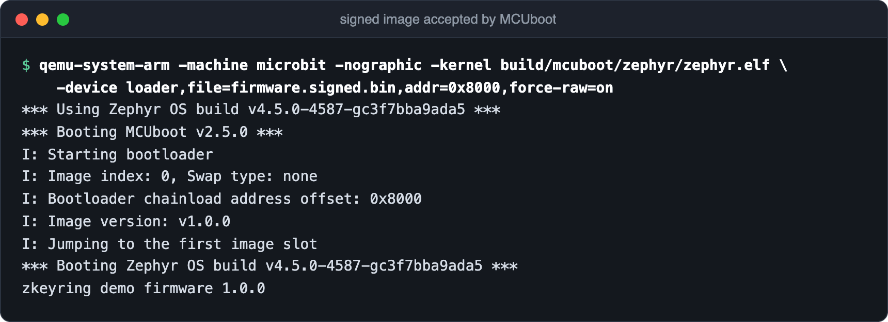
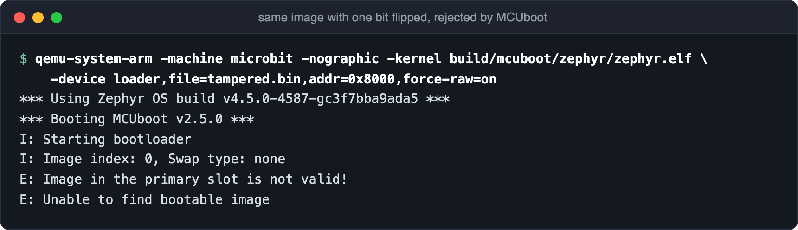

Getting started
===============

This guide creates a development key in your OS keyring, signs the sample
application and boots it in QEMU. You need a working
:external+zephyr:ref:`Zephyr environment <getting_started>` and
``qemu-system-arm``.

1. Set up the workspace
-----------------------

From the zkeyring repository, initialize its development workspace and install
the Python dependencies in the virtual environment. ``west-dev.yml`` selects the
Zephyr and MCUboot revisions used to test zkeyring.

.. code-block:: sh

   west init -l --mf west-dev.yml .
   west update --narrow -o=--depth=1
   west packages pip --install

The ``west zkeyring`` command is now available.

.. code-block:: sh

   west zkeyring --help

To add zkeyring to an existing workspace instead, see :ref:`add-to-manifest`.

2. Create a development key
---------------------------

Generate an ECDSA P-256 key and store it in the OS keyring. The private key
goes through a pipe and is not written to a file.

.. code-block:: sh

   openssl genpkey -algorithm EC -pkeyopt ec_paramgen_curve:P-256 |
       python -m keyring set zkeyring-demo firmware

3. Describe the key in a profile
--------------------------------

Choose a directory for the demonstration and create the profile file.

.. code-block:: sh

   demo=$(mktemp -d)
   cat > "$demo/zkeyring.toml" <<'EOF'
   [profiles.default]
   backend = "local-keyring"
   service = "zkeyring-demo"
   key = "firmware"
   EOF

Export the public key, then pin its fingerprint in the profile. You created
this key a moment ago, so its origin is known. For a shared key, confirm the
fingerprint through a trusted channel before pinning it.

.. code-block:: sh

   west zkeyring public-key --config "$demo/zkeyring.toml" \
       --profile default > "$demo/signing-public.pem"
   echo "fingerprint = \"$(west zkeyring fingerprint "$demo/signing-public.pem")\"" \
       >> "$demo/zkeyring.toml"

4. Build and sign
-----------------

.. code-block:: sh

   west build -b qemu_cortex_m0 --sysbuild samples/signed_firmware \
       -d "$demo/build" -- \
       "-DSB_CONFIG_BOOT_SIGNATURE_KEY_FILE=\"$demo/signing-public.pem\"" \
       "-DZKEYRING_CONFIG=$demo/zkeyring.toml" \
       '-Dsigned_firmware_CONFIG_MCUBOOT_IMGTOOL_SIGN_VERSION="1.0.0"'

Sysbuild compiles MCUboot with the public key, compiles the application, and
runs zkeyring to sign it. The result is
``build/signed_firmware/zephyr/zephyr.signed.bin``.

5. Boot it
----------

.. code-block:: sh

   qemu-system-arm -machine microbit -nographic \
       -kernel "$demo/build/mcuboot/zephyr/zephyr.elf" \
       -device "loader,file=$demo/build/signed_firmware/zephyr/zephyr.signed.bin,addr=0x8000,force-raw=on"

Press :kbd:`Ctrl-A` then :kbd:`X` to exit QEMU.

   MCUboot accepts a signed image and starts the application.

   The same kind of image with one bit changed. MCUboot refuses to boot it.

Clean up
--------

Remove the demonstration key when you are done.

.. code-block:: sh

   python -m keyring del zkeyring-demo firmware

Next, read :doc:`concepts` or choose a backend in :doc:`backends/index`.
